# 016 基于文本相似度的学生作业查重系统-设计展示

> **代码有偿获取 可接受定制 微信联系方式: csbysj2020 或 ACE2487，备注(BS)**

> **完整源码与全套文档 · 在线自助获取 >>> [https://mbd.pub/o/bread/YZaWlZZqZw==](https://mbd.pub/o/bread/YZaWlZZqZw==)**

> **成品页（功能介绍 / 更多选题）>>> [https://bishe.suilang.net/products/text-plagiarism-checker](https://bishe.suilang.net/products/text-plagiarism-checker)**

> 

> 

## 视频

> **点击查看 >>> [https://www.bilibili.com/video/BV13B4t6NE1r/](https://www.bilibili.com/video/BV13B4t6NE1r/)**

## 项目简介

面向教师的学生作业查重与相似度检测系统：上传作业后与库内所有作业比对，给出综合相似度（0.5×TF-IDF 余弦 + 0.5×n-gram Jaccard）、判定结论，并定位相似片段（双栏高亮）。技术主线是「算得准、算得快、说得清」：SimHash 粗筛 → 精算 → 句子级片段定位，算法全部自行实现、不依赖第三方查重服务。

课程作业的互相抄袭是教学中的常见问题，而人工比对效率极低：教师既难发现「同义替换后照抄」「调换语序」这类改写式抄袭，又要面对「同主题作业共享教材表述」造成的大量误报。

本项目设计并实现了一套学生作业查重系统，围绕「算得准、算得快、说得清」三条主线组织技术与交互。

算法方面不使用第三方查重库，全部自行实现：先做 jieba 分词与停用词过滤，再同时构建三类表征——(1) n-gram 指纹（k=4）集合与 Jaccard 相似度，度量词片段重合度；(2) SimHash 64 位指纹与汉明距离，用于候选粗筛；(3) TF-IDF 余弦，把「查询 + 候选」组成小语料计算词权后求余弦。

本仓库为**设计展示**：包含项目说明、技术架构、实验结果与运行截图；完整源码、任务书、开题报告、毕业论文与使用说明可通过上方链接自助获取，成品页可查看更多选题，也可联系微信咨询定制。

## 功能特性

1. 三件武器各司其职：n-gram 指纹(k=4)+Jaccard 度量片段重合，TF-IDF 余弦度量词权分布，SimHash 64 位只做候选粗筛

2. 综合相似度 = 0.5×余弦 + 0.5×Jaccard；判定线 0.60 取自离线实验的最优阈值（≥0.75 高度相似 / ≥0.60 可疑）

3. 句子级片段定位：逐句字符 3-gram Jaccard 取最佳匹配并合并连续命中句，结果页双栏高亮、悬停显示匹配分数

4. 带标注仿真语料与对比实验：80 篇作业 / 32 篇抄袭样本 / 90 组配对，四种指标的区分度与阈值网格 P/R/F1 全部可复现

5. SimHash 候选筛选取舍量化：汉明距离 ≤4 召回 0.875 正样本、仅放行 1.7% 负样本（≤6 为 0.906 / 6.9%）

6. 上传解析：粘贴文本或上传 txt，自动识别 UTF-8 / GBK / UTF-16 编码

7. 工程实现：全库分词/指纹/TF-IDF 进程内缓存（按作业数自动失效重建），单次查重毫秒级

8. 算法评估页：区分度对比、阈值—P/R/F1 曲线、候选筛选取舍三张图，数字直接读自评估脚本输出

## 技术架构

| 项目 | 说明 |
| --- | --- |
| 编程语言 | Python 3.8 及以上 |
| 后端框架 | Django 4.2 |
| 文本处理 | jieba 0.42（分词） |
| 算法 | NumPy 手写：n-gram 指纹、SimHash、TF-IDF 余弦、Jaccard、句子对齐（不用第三方查重服务） |
| 数据库 | MySQL 8.0（交付默认 SQLite，免安装） |
| 可视化 | ECharts 5（已内置本地文件，离线可用） |
| 操作系统 | Windows / macOS / Linux |
| 启动方式 | 双击一键脚本，或 python manage.py runserver 8081 |

## 目录结构

以下为完整交付版的结构（本仓库仅作设计展示）：

```
text-plagiarism-checker/
├── 任务书/
│   └── 毕业设计任务书.docx
├── 开题报告/
│   └── 毕业设计开题报告.docx
├── 最终论文/
│   ├── 图/
│   │   ├── 图3-1_系统用例图.png
│   │   ├── 图4-1_系统架构图.png
│   │   ├── 图4-2_功能模块图.png
│   │   ├── 图4-3_查重流程图.png
│   │   └── 图4-4_数据库ER图.png
│   └── 基于文本相似度的学生作业查重系统设计.docx
├── 源码/
│   ├── checker/
│   │   ├── __init__.py
│   │   ├── settings.py
│   │   ├── urls.py
│   │   └── wsgi.py
│   ├── data/
│   ├── homework/
│   │   ├── management/
│   │   ├── migrations/
│   │   ├── __init__.py
│   │   ├── admin.py
│   │   ├── apps.py
│   │   ├── models.py
│   │   ├── urls.py
│   │   └── views.py
│   ├── similarity/
│   │   ├── artifacts/
│   │   ├── __init__.py
│   │   ├── corpus.py
│   │   ├── engine.py
│   │   ├── evaluate.py
│   │   └── service.py
│   ├── static/
│   │   ├── css/
│   │   └── vendor/
│   ├── templates/
│   │   ├── homework/
│   │   └── {homework}/
│   ├── db.sqlite3
│   └── …
└── …
```

## 数据与实验结论

- 系统的判定分数取综合相似度 = 0.5 × 余弦 + 0.5 × Jaccard，SimHash 只参与筛选、不参与打分；在句子粒度上用字符 3-gram Jaccard 做对齐，取每句最佳匹配并合并连续命中句，得到相似片段，在结果页以双栏高亮呈现。
- 为验证算法并确定阈值，本项目自建了一份带标注的仿真语料：80 篇作业，每篇由 1 段公共「教材表述」与 3 段个人实验说明（模板 + 随机参数生成）构成；其中 32 篇对指定源作业施加已知变换生成抄袭样本（整段照抄 / 同义替换 / 语序调换 / 轻微改写 / 部分照抄），并记录标注。
- 在该语料上测得：n-gram Jaccard 的区分度最高（正样本均值 0.845 vs 负样本 0.103，差 0.742），TF-IDF 余弦次之（0.952 vs 0.361，差 0.591），SimHash 单独区分度最低（0.973 vs 0.816，差 0.157）——这恰好说明它适合做粗筛而非打分。
- 综合相似度在阈值 0.60 时取得最佳综合表现：Precision 1.000、Recall 0.906、F1 0.951、准确率 0.967；3 个漏检全部是「部分照抄」样本。
- 候选筛选取舍方面，汉明距离 ≤ 4 时正样本召回 0.875、仅 1.7% 的负样本被放行，≤ 6 时召回升到 0.906、放行 6.9%，为「粗筛 + 精算」提供了可调的折中。
- 系统侧实现了上传解析（粘贴或 txt，自动识别 UTF-8/GBK/UTF-16）、库内查重与 Top-K 排名、双栏结果页、两两比对、算法评估页与 Django Admin，并对超短文本、无相似作业等边界做了处理。

## 交付内容

1. 完整源码（Django 工程 + 自行实现的相似度算法 + 仿真语料生成器 + 离线评估脚本）
2. 演示数据库（80 篇仿真作业，含 32 篇带标注抄袭样本）与评估指标文件 metrics.json
3. 毕业设计任务书（Word）
4. 开题报告（Word）
5. 毕业论文（Word，七章制，含评估实验与阈值选择章节）
6. 系统使用与二次开发说明（Word + md）
7. 11 张系统运行截图

## 常见问题

**查重准确率怎么样？**

在带标注仿真语料（80 篇 / 90 组配对）上，综合相似度阈值 0.60 时 Precision 1.000、Recall 0.906、F1 0.951、准确率 0.967；3 个漏检全部是「部分照抄」样本。

**判定阈值 0.6 是怎么来的？**

在 0.20–0.90（步长 0.05）的阈值网格上做搜索，取综合相似度 F1 与准确率最优的阈值。实验里综合相似度在 0.60 就达到最佳 F1 0.951，而单独用余弦要等到 0.90 才达标，阈值越低对真实改写越宽容。

**为什么还要用 SimHash？**

SimHash 单独打分的区分度只有 0.157（正样本均值 0.973 / 负样本 0.816），不适合判定；但它适合粗筛——汉明距离 ≤4 能召回 87.5% 的抄袭样本，却只放行 1.7% 的正常作业，可以把精算量压缩一个数量级。

**结果只有一个分数吗？**

不是。结果页给出四个分项（TF-IDF 余弦、n-gram Jaccard、SimHash 相似度、汉明距离）与相似片段数与字数，并用双栏高亮定位到具体句子，鼠标悬停可看该句的最佳匹配分数。

**改写的抄袭能查出来吗？**

同义替换、语序调换、轻微改写都能识别（Jaccard 对成段重合敏感、余弦对词权分布敏感）；但「部分照抄」和深度语义改写是整篇相似度方法的固有短板，论文 7.2 给出了改进方向（段落级局部相似度、句向量语义匹配）。

**能换语料或课程吗？**

能。上传页支持粘贴文本或上传 txt（自动识别 UTF-8/GBK/UTF-16）；也可以在 similarity/corpus.py 换掉知识段落池并重跑 seed_corpus 与 run_eval。

## 截图

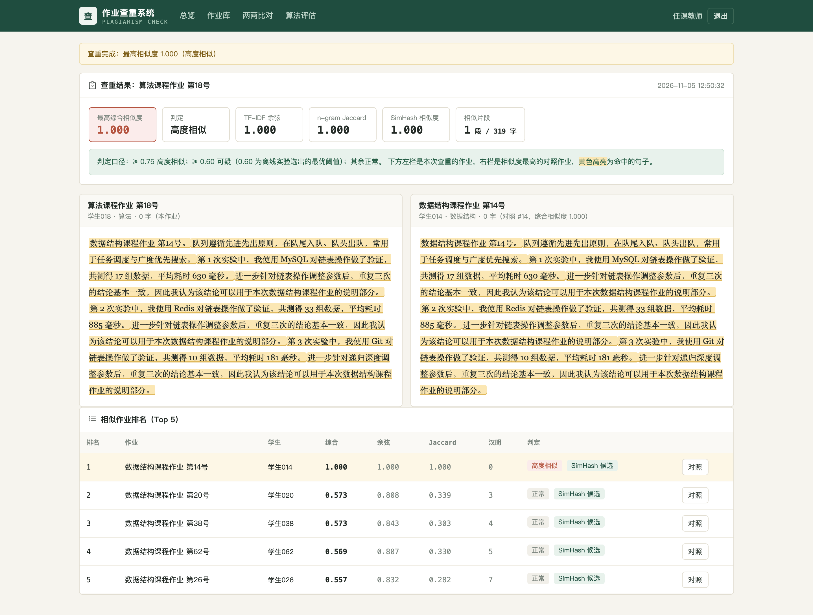
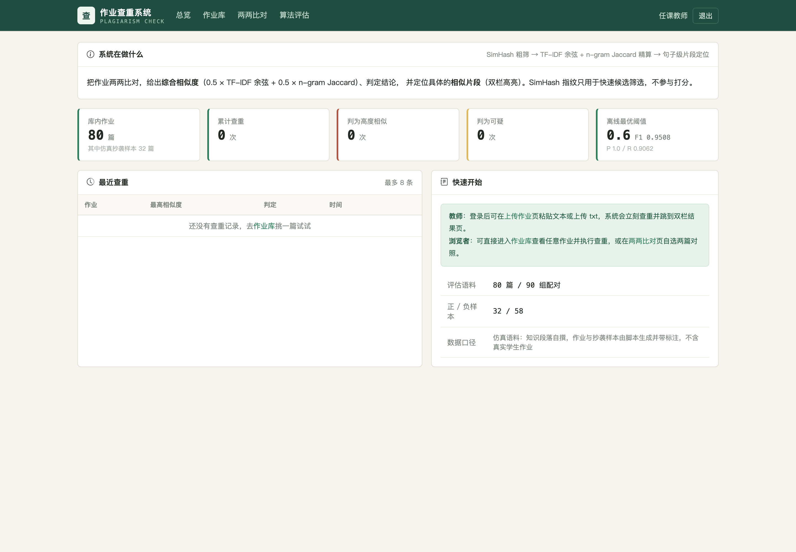
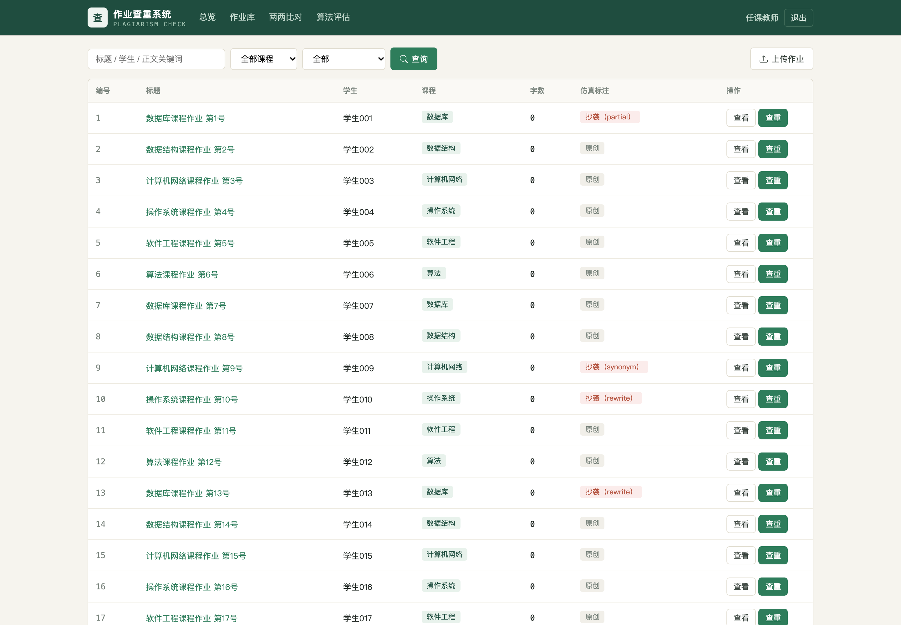
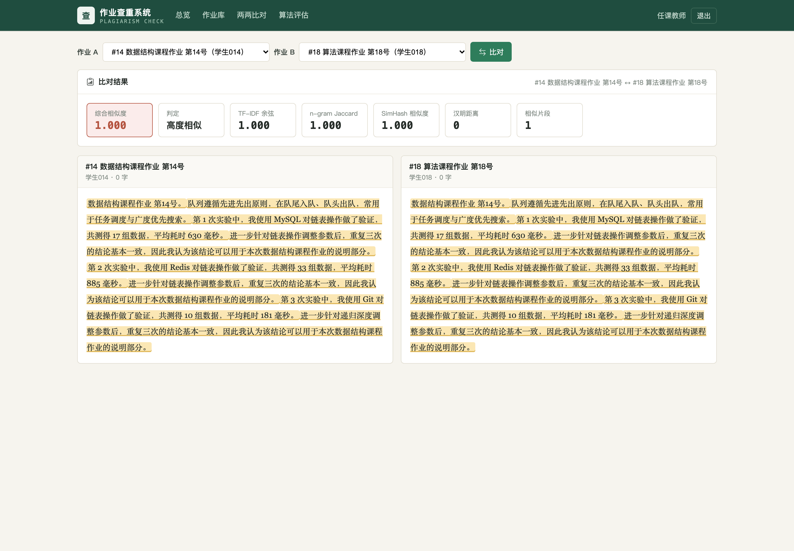
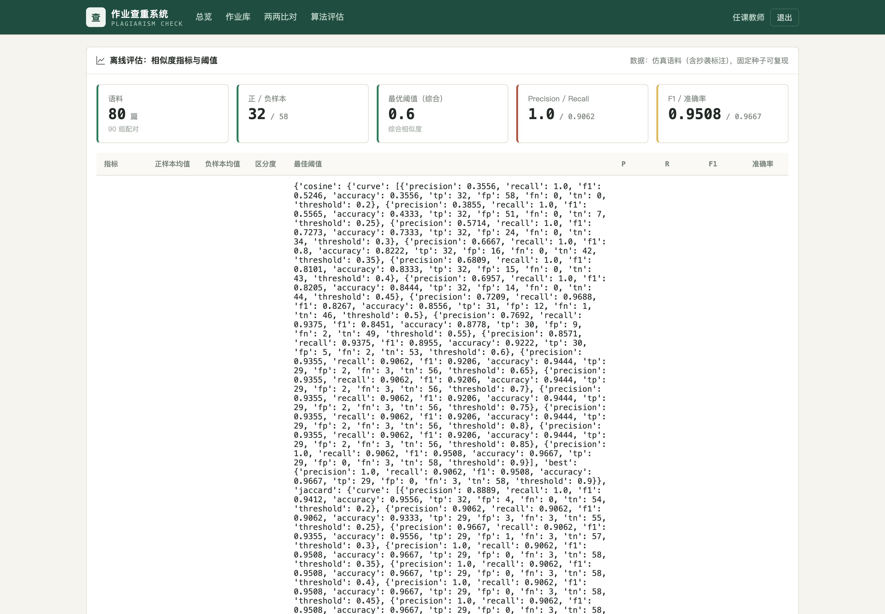
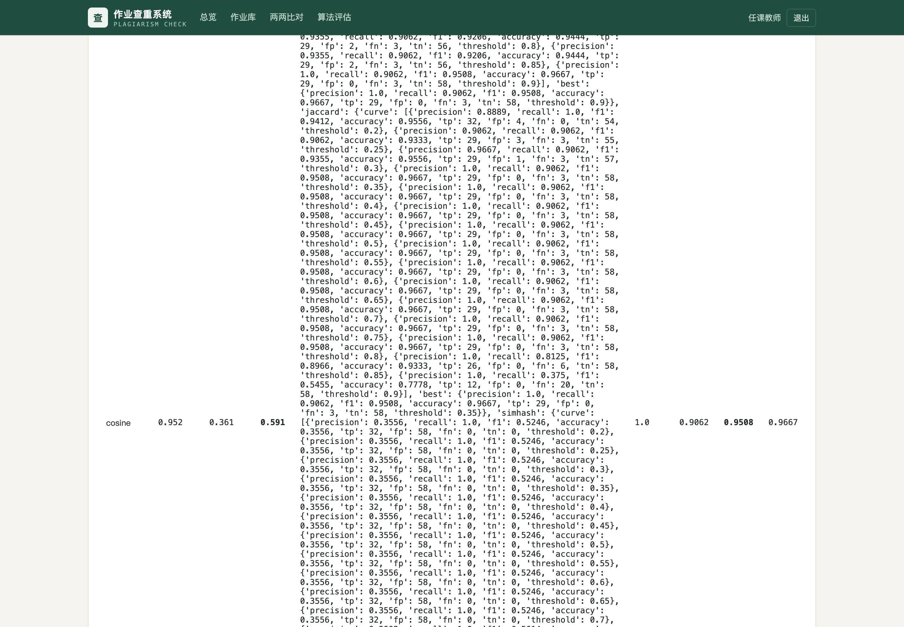
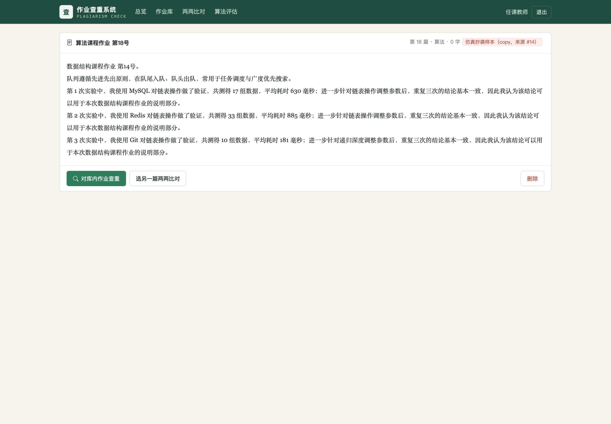
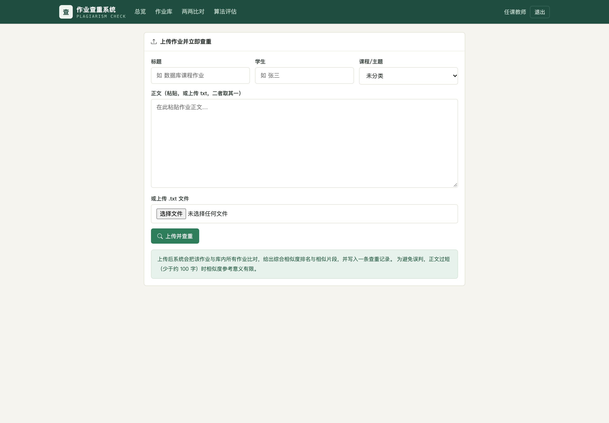
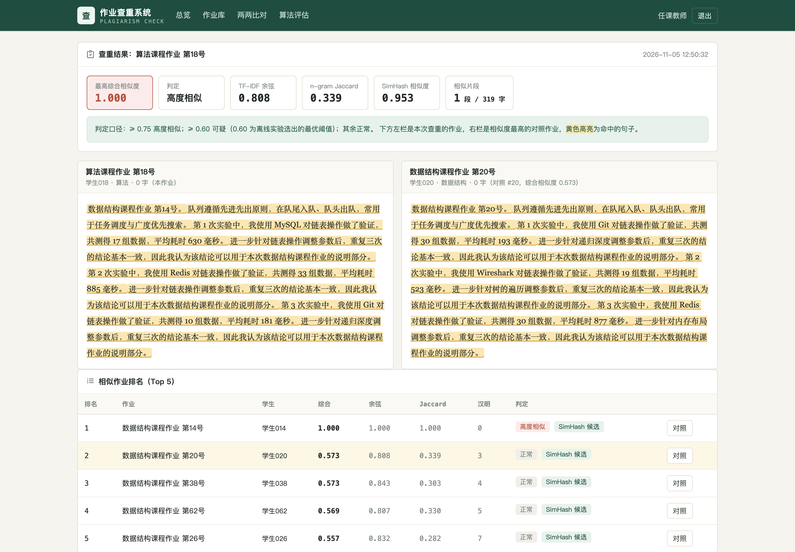
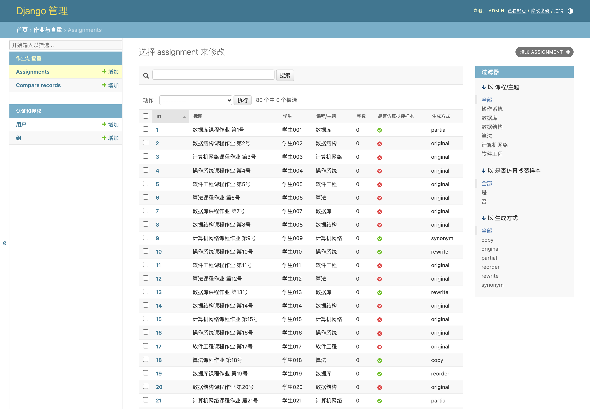
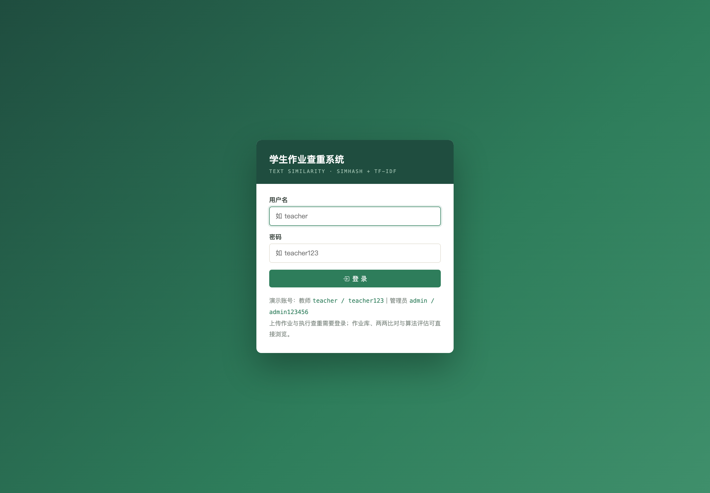
